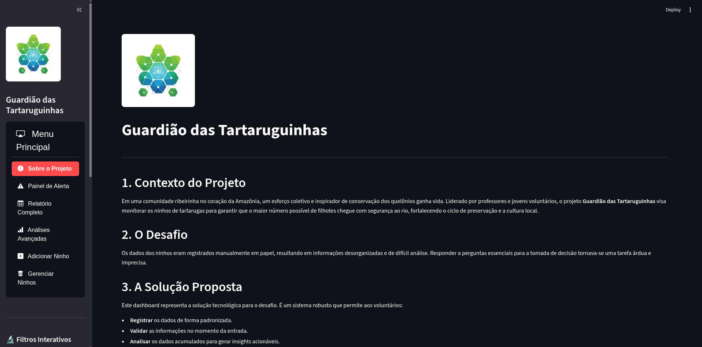
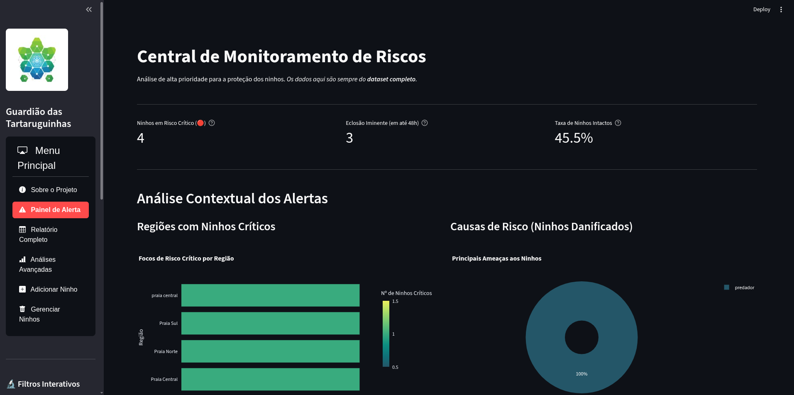
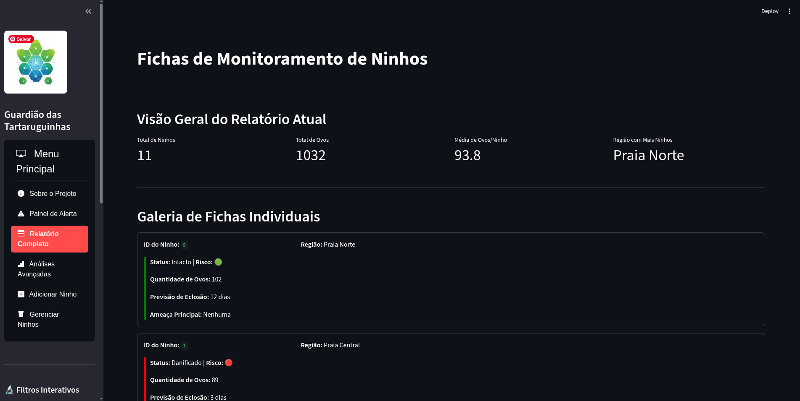
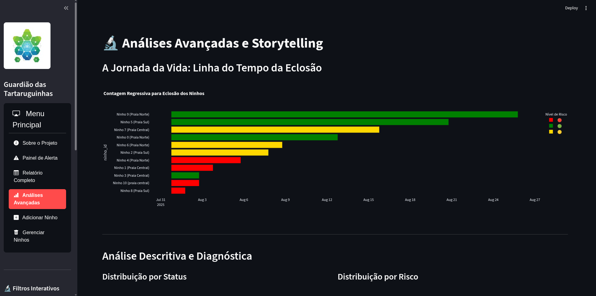
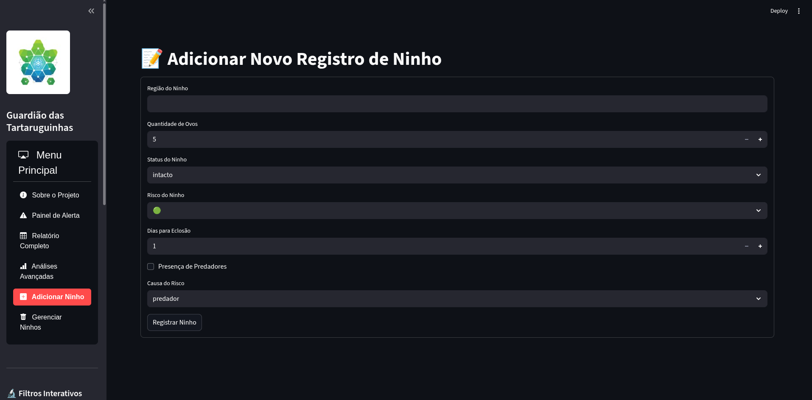
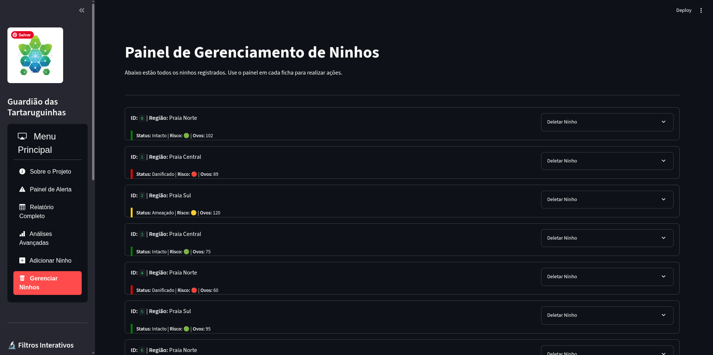

# Guardião das Tartaruguinhas

**Protótipo de dashboard para organizar registros de ninhos de quelônios e apoiar o monitoramento comunitário de conservação na Amazônia.**

O projeto foi desenvolvido no contexto do curso **IA Aplicada aos Desafios Socioambientais da Amazônia (I2A2)**. A proposta é demonstrar como registros organizados podem ajudar equipes de campo a acompanhar ninhos, revisar situações de risco e priorizar a atenção — sem substituir a observação e a decisão dos responsáveis pela conservação.

## Problema e proposta

Registros feitos manualmente podem ficar dispersos e dificultar consultas, comparação de situações e acompanhamento ao longo do tempo. O Guardião organiza esses registros em uma interface de análise para tornar informações relevantes mais fáceis de consultar.

## Funcionalidades

- **Central de monitoramento de riscos:** apresenta indicadores e alertas a partir dos registros disponíveis.
- **Fichas de ninhos:** permite consultar informações organizadas por registro.
- **Análises visuais:** reúne gráficos e resumos para observar padrões nos dados.
- **Linha do tempo e filtros:** apoiam a exploração dos registros conforme as funcionalidades presentes na aplicação.
- **Tratamento explícito de dados incompletos:** o painel diferencia ausência de registros, esquema inválido e classificações de risco desconhecidas, em vez de concluir que a falta de informação significa ausência de risco.

## Capturas de tela

| Central de monitoramento | Fichas de monitoramento |
|:---:|:---:|
|  |  |

| Análises e linha do tempo | Painel de gerenciamento |
|:---:|:---:|
|  |  |

| Filtros interativos | Formulário de registro |
|:---:|:---:|
|  |  |

## Tecnologias

- **Python:** lógica e processamento dos registros.
- **Streamlit:** interface interativa.
- **Pandas:** leitura e manipulação dos dados tabulares.
- **Plotly:** visualizações.
- **streamlit-option-menu:** navegação.
- **pytest:** testes automatizados das funções de dados e persistência.

## Executar localmente

Requisitos: Python 3.8 ou superior, pip e venv.

```bash
git clone https://github.com/enps2015/guardiao-das-tartaruguinhas.git
cd guardiao-das-tartaruguinhas

python -m venv .venv
source .venv/bin/activate
# Windows PowerShell: .venv\\Scripts\\Activate.ps1

python -m pip install -r requirements.txt
python -m pip install pytest
python -m pytest -q
streamlit run dashboard.py
```

O Streamlit inicia a aplicação no navegador. Os comandos de ativação do ambiente virtual variam conforme o sistema operacional.

## Limitações e uso responsável

**Esta versão deve ser considerada um protótipo demonstrativo, não um sistema de produção para registros oficiais de campo.**

A aplicação utiliza `data/ninhos.csv` como armazenamento local. A gravação atômica reduz o risco de deixar um arquivo parcialmente escrito após uma interrupção, mas não fornece durabilidade garantida na nuvem, backup, controle de acesso ou suporte seguro a gravações simultâneas de vários usuários. Em ambientes como o Streamlit Community Cloud, o filesystem local pode não persistir após reinicializações ou novos deploys.

Antes de uma operação real, será necessário adotar armazenamento persistente externo, controle de acesso, política de backup e um processo de recuperação testado. Os alertas gerados pelo painel devem apoiar — e não substituir — a avaliação dos responsáveis em campo. Não se deve interpretar dados ausentes ou classificações desconhecidas como prova de que um ninho está seguro.

## Testes e integração contínua

O repositório contém testes automatizados para a classificação do estado de risco e a gravação atômica do CSV. Para executá-los localmente:

```bash
python -m pytest -q
```

O workflow do GitHub Actions instala as dependências, verifica a sintaxe e executa a suíte de testes em alterações relevantes. A existência de testes não equivale à validação operacional em campo nem comprova persistência em produção.

## Autor

**Eric Pimentel**

- [GitHub](https://github.com/enps2015)
- [LinkedIn](https://www.linkedin.com/in/ericpimentel-dados/)
- [Instagram](https://www.instagram.com/eric.n.pimentel/)

---

*Última atualização documental: 27 de outubro de 2026.*
